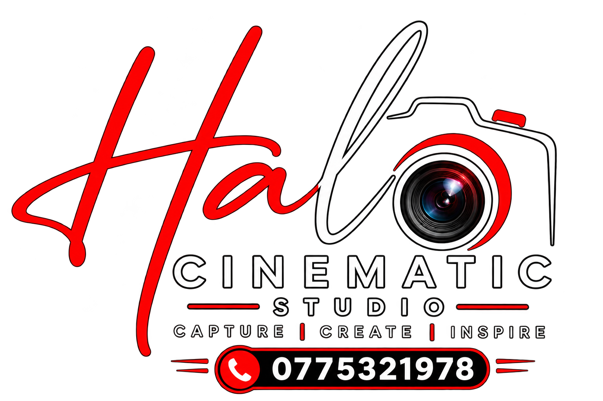

# HALO CINEMATIC STUDIO — Website

Professional website for **HALO CINEMATIC STUDIO**, a photography, cinematography, and creative studio based in Sri Lanka.

> **Capture • Create • Inspire**



---

## 🎬 Overview

This repository contains the full source code for the HALO Cinematic Studio website — a modern, responsive, and visually refined web application built with **Next.js 16**, **React 19**, **TypeScript**, and **Tailwind CSS 4**.

The site showcases the studio's photography and cinematography services across **Weddings**, **Puberty Ceremonies**, **Engagements**, and **Special Events**, with transparent package pricing and a direct **WhatsApp enquiry system** for bookings.

---

## 🛠️ Tech Stack

| Technology | Role |
|---|---|
| [Next.js 16](https://nextjs.org/) (App Router) | Framework & SSR/SSG |
| [React 19](https://react.dev/) | Component UI |
| [TypeScript](https://www.typescriptlang.org/) | Type safety |
| [Tailwind CSS 4](https://tailwindcss.com/) | Utility-first styling |
| [Motion (Framer Motion)](https://motion.dev/) | Animations & page transitions |
| [Lucide React](https://lucide.dev/) | Icon system |

---

## 📁 Project Structure

```
halo_cinematic_studio_website/
├── index.html                    # Original static HTML backup
├── README.txt                    # Original static site readme
├── halo-cinematic-studio/        # ← Main Next.js application
│   ├── public/
│   │   ├── images/
│   │   │   ├── flyers/           # 14 official package brochure sheets
│   │   │   └── photos/           # 4 cropped wedding couple portraits
│   │   ├── logos/                 # Studio logo (Logo 1.png)
│   │   ├── audio/                # Background music (optional)
│   │   └── icons/
│   ├── src/
│   │   ├── app/                  # Next.js App Router pages
│   │   ├── components/           # Reusable UI components
│   │   ├── config/               # Site configuration (site.ts)
│   │   ├── data/                 # Packages, photos & services data
│   │   └── lib/                  # Utilities & hooks
│   └── package.json
└── .gitignore
```

---

## 🚀 Getting Started

### Prerequisites

- **Node.js** 18.17 or later
- **npm** 9+

### Installation

```bash
cd halo-cinematic-studio
npm install
```

### Development

```bash
npm run dev
```

Open [http://localhost:3000](http://localhost:3000) in your browser.

### Production Build

```bash
npm run build
npm run start
```

### Type Check & Lint

```bash
npx tsc --noEmit
npm run lint
```

---

## 🗺️ Pages & Routes

| Route | Page | Description |
|---|---|---|
| `/` | Home | Hero with studio logo & wedding portraits, About preview, featured packages, photo gallery preview, and contact CTA |
| `/about` | About | Studio story, mission & philosophy (Capture • Create • Inspire), and craft disciplines |
| `/packages` | Packages | Interactive tabbed explorer for all 24 packages across 4 categories with pricing cards |
| `/photos` | Photos | Filterable gallery with darkroom lightbox (Wedding Portraits, Wedding/Engagement/Event brochures) |
| `/contact` | Contact | WhatsApp enquiry form with event category & package selection, direct channel links |

### Legacy Redirects

Old bookmarked URLs redirect cleanly:

| Old Route | Redirects To |
|---|---|
| `/services` | `/packages` |
| `/portfolio` | `/photos` |
| `/booking` | `/contact` |
| `/team` | `/about` |

---

## 📦 Packages & Pricing

The site showcases **24 studio packages** across 4 categories, all sourced from official studio brochures:

| Category | Packages | Price Range |
|---|---|---|
| **Wedding** | Silver Basic, Silver Standard, Royal Golden, Diamond Platinum | LKR 197,500 – 565,500 |
| **Puberty Ceremony** | Basic 01–03, Standard 01–04 (Royal Ultimate) | Rs. 100,000 – 355,000 |
| **Engagement & Registration** | Basic 01–03, Standard 01, Outstanding 01–03 | Rs. 65,000 – 315,000 |
| **Event & Portrait** | Photo-Only (Basic/Standard/Outstanding), Photo & Cinema (Basic/Standard/Outstanding) | Rs. 50,000 – 150,000 |

---

## 🎨 Design System

The site uses a **White + Black + Red** editorial studio theme:

| Token | Colour | Usage |
|---|---|---|
| Canvas | `#FFFFFF` | Primary background |
| Paper | `#F6F5F3` | Alternating section surfaces |
| Ink | `#0A0A0B` | Text, headings, dark contrast cards |
| Brand | `#ED171F` | HALO red — accents, CTAs, highlights |
| Brand Deep | `#C40E15` | Darker red for text on light surfaces |

---

## 📞 Contact Information

| Channel | Details |
|---|---|
| **Phone / WhatsApp** | 077 532 1978 (`+94 77 532 1978`) |
| **Email** | halostudio18@gmail.com |
| **WhatsApp Enquiry** | [wa.me/94775321978](https://wa.me/94775321978) |

---

## ⚙️ Configuration

All studio branding, contact info, navigation, and social links are managed in a single config file:

**[`src/config/site.ts`](halo-cinematic-studio/src/config/site.ts)**

Key editable fields:

- `name`, `tagline`, `motto`, `description` — Studio branding copy
- `contact.phoneDisplay`, `contact.email` — Contact details
- `logo.src` — Logo image path
- `nav` — Navigation links
- `socials` — Instagram, Facebook, etc. (add when available)
- `backgroundMusic` — Path to optional background MP3

Package data lives in **[`src/data/packages.ts`](halo-cinematic-studio/src/data/packages.ts)** and photo/gallery data in **[`src/data/photos.ts`](halo-cinematic-studio/src/data/photos.ts)**.

---

## 📄 License

This project is proprietary to **HALO CINEMATIC STUDIO**. All photographs, branding assets, and studio content are the property of HALO Cinematic Studio.

---

<p align="center">
  <strong>HALO CINEMATIC STUDIO</strong><br>
  <em>Capture • Create • Inspire</em><br>
  077 532 1978 · halostudio18@gmail.com
</p>
